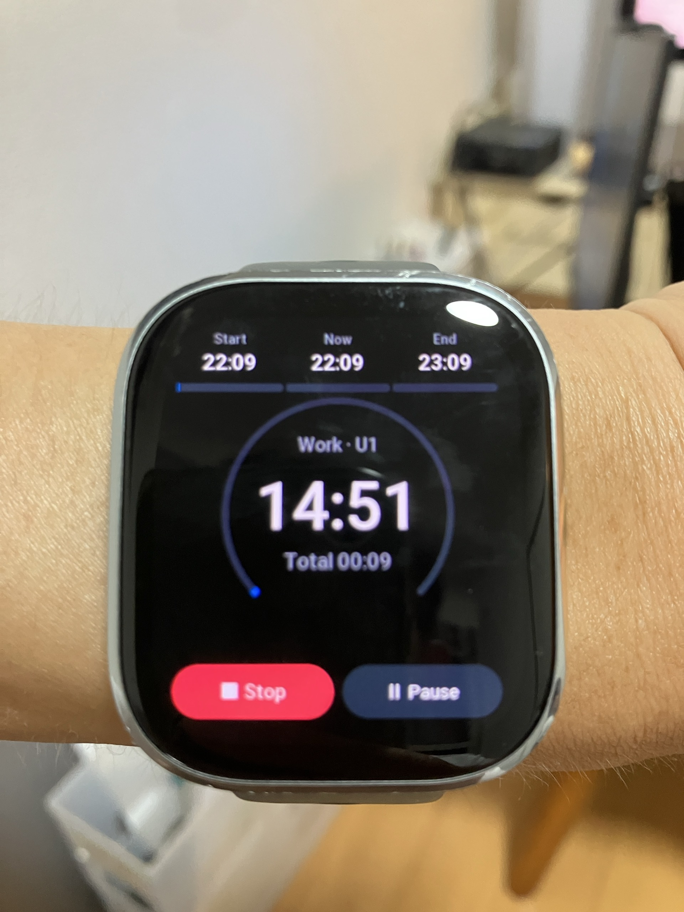

# PacePilot 

> 腕元だけで集中と休憩を切り替えられるZepp OS向けポモドーロタイマー

## これは何？

Pace Pilotは、固定プリセット（定番の`25 / 5`や`15 / 5`など）から選ぶだけで開始できるAmazfit向け
ポモドーロタイマーです。作業・休憩の自動切替、3ラウンドの進捗、終了予定、
一時停止、スキップ、振動通知を390×450の画面で見やすく表示します。

## こんな時に使えます

- 勉強や仕事で集中と休憩を繰り返したいとき
- `25分＋5分`や`15分＋5分`などの作業ペースを腕元で管理したいとき
- スマートフォンを見ずに残り時間を確認したいとき

## 使い方

1. `10 / 5`、`15 / 5`、`20 / 10`、`25 / 5`、`50 / 10`、またはオリジナルの「Custom」からプリセットを選びます。
   - `Custom ›` ボタンから、作業時間（Work）と休憩時間（Break）を自由にカスタマイズして保存できます。
2. `Start`を押すと、作業と休憩が3ラウンド自動で切り替わります。
3. 必要に応じて一時停止、再開、スキップ、途中終了ができます。
4. 最終休憩が終わると振動し、完了画面を表示します。

現在はAmazfit Bip 6で実機検証中です。Zepp App Storeでの正式公開後、
インストール先をこのページに追記します。

## 技術・開発について

開発環境、ビルド、実機プレビューについては
[DEVELOPER.md](./DEVELOPER.md)を参照してください。

## ライセンス

[MIT License](./LICENSE)

## 関連リンク

- [ポートフォリオ](https://165cm.github.io/portfolio/apps/pace-pilot)
- [プライバシー方針](./docs/privacy-policy-en.md)
